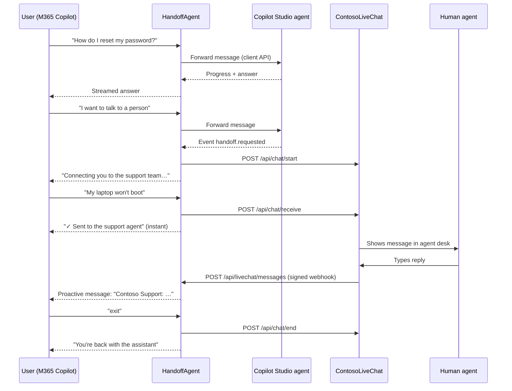

# Live Agent Handoff in Microsoft 365 Copilot

This sample shows how a Copilot Studio agent used in **Microsoft 365 Copilot** can hand a conversation to a **live agent** in a contact center, with the agent's replies arriving **in the same Copilot chat**.

## Background

A Copilot Studio agent published to Microsoft 365 Copilot can't receive messages from a live agent after the user's turn has ended. The [skill handoff sample](https://github.com/microsoft/CopilotStudioSamples/tree/main/contact-center/skill-handoff) and the [Genesys handoff sample](https://github.com/microsoft/Agents/tree/main/samples/dotnet/genesys-handoff) solve this for **Microsoft Teams** with proactive messages. Microsoft 365 Copilot behaves differently in two ways that break those patterns:

- **Every message the user sends must get a reply.** During a handoff the agent has nothing to say until the human answers. If it stays silent, Microsoft 365 Copilot shows *"The agent may still be processing your request…"* and then locks the chat. The reply must also be sent as a **streamed** response: a plain `sendActivity` reply is accepted by the service but not shown, so the chat locks anyway.
- **Slow answers time out.** Microsoft 365 Copilot expects a first response within 15 seconds and updates at least every 45 seconds. Generative answers from Copilot Studio can take longer.

## What This Sample Does

A small **custom engine agent** (built with the [Microsoft 365 Agents SDK](https://learn.microsoft.com/microsoft-365/agents-sdk/)) sits in front of your Copilot Studio agent. Users chat with it in Microsoft 365 Copilot. It:

- **Forwards normal questions** to your Copilot Studio agent through the [Copilot Studio client API](https://learn.microsoft.com/microsoft-copilot-studio/publication-integrate-web-or-native-app-m365-agents-sdk) and **streams** the answer back with progress updates, so slow answers don't time out.
- **Starts a live chat** in the contact center when the Copilot Studio **Escalate** topic sends a `handoff.requested` event.
- **Acknowledges every message immediately** during the handoff (*"✓ Sent to the support agent"*, as a streamed reply with an **Exit chat with agent** card), so Microsoft 365 Copilot never locks the chat.
- **Pushes the human agent's replies** into the same Copilot chat with [proactive messaging](https://learn.microsoft.com/microsoft-365/agents-sdk/proactive-overview).
- **Returns the user to the assistant** when they type *exit* (or press **Exit chat with agent**), or when no human replies within 5 minutes.

Your Copilot Studio agent keeps all its topics, knowledge and tools. The only change is the Escalate topic.

## Solution

| Folder | What it is |
|---|---|
| [`HandoffAgent/`](./HandoffAgent/) | The custom engine agent (Node.js, Microsoft 365 Agents SDK). This is what users open in Microsoft 365 Copilot. |
| [`ContosoLiveChat/`](./ContosoLiveChat/) | A mock contact center with an agent desk at `http://localhost:5000`. **Replace it** with your real system (Genesys, ServiceNow, Salesforce…). |
| [`copilot-studio/Escalate.yaml`](./copilot-studio/Escalate.yaml) | Escalate topic that sends the `handoff.requested` event. |
| `setup.ps1` / `cleanup.ps1` | Create (and delete) the dev tunnel, Entra app, Azure Bot, config files and app package in one go. |
| [`telemetry/`](./telemetry/) | **Optional (Option B):** end-to-end telemetry in Application Insights, with a setup script and ready-made queries. |

### How It Works



## Prerequisites

- **Microsoft 365 tenant** with Microsoft 365 Copilot and Copilot Studio, where you can [upload custom apps to Teams](https://learn.microsoft.com/microsoftteams/platform/concepts/build-and-test/prepare-your-o365-tenant#enable-custom-teams-apps-and-turn-on-custom-app-uploading).
- **Azure subscription in the same tenant**, with rights to create a resource group and an app registration.
- **Copilot Studio agent** that:
  - is a standard (classic) agent, created in the Copilot Studio portal or with `pac copilot init` (default authoring mode). Agents built on the new CLI-authored / GitHub Copilot harness can't be called through the Copilot Studio client API. Generative orchestration is fine; it was used to test this sample.
  - has authentication set to **Authenticate with Microsoft** (the default).
  - is **published**.
- **Tools on your machine:**
  - [Node.js 20.6+](https://nodejs.org) (for `--env-file`)
  - [Azure CLI](https://aka.ms/installazurecli)
  - [Dev Tunnels CLI](https://learn.microsoft.com/azure/developer/dev-tunnels/get-started) (`winget install Microsoft.devtunnel`)
  - PowerShell 7 (`setup.ps1` doesn't run in Windows PowerShell 5.1)
- **Free local ports 3978 and 5000.** If another copy of the sample (or anything else) is using them, stop it first: both servers exit with an error if their port is taken.

## Installation

1. **Sign in to Azure and Dev Tunnels.** The Azure CLI account must be in your Microsoft 365 tenant. The Dev Tunnels account can be any account (the tunnel allows anonymous access):

    ```powershell
    az login
    devtunnel user login
    ```

1. **Get your Copilot Studio agent's IDs.** In Copilot Studio, open your agent, go to **Settings > Advanced > Metadata**, and copy the **Environment Id** and **Schema name**.

1. **Update the Escalate topic.** In your agent, open **Topics > System > Escalate**, then **⋯ > Open code editor**. Replace the contents with [`copilot-studio/Escalate.yaml`](./copilot-studio/Escalate.yaml), save, and **Publish** the agent.

    {: .note }
    > The built-in *Transfer conversation* node can't be used here: Copilot Studio only allows it on channels with an engagement hub (it fails with `TransferConversationNotSupported`). The sample uses an event instead.

    {: .note }
    > If you edit the agent locally (PAC CLI or the Copilot Studio VS Code extension) instead of in the code editor, keep the `mcs.metadata` header at the top of `topics/Escalate.mcs.yml` and replace only the rest of the file.

1. **Run the setup script** from this folder:

    ```powershell
    ./setup.ps1 -EnvironmentId <Environment Id> -AgentSchemaName <Schema name>
    ```

    It creates a dev tunnel, an Entra app registration, an Azure Bot (F0, free) with the Teams channel, both `.env` files (with a generated webhook secret), and the app package `HandoffAgent/appPackage/handoff-demo-app.zip`.

    {: .note }
    > If you aren't an admin, the script can't grant consent for the *CopilotStudio.Copilots.Invoke* permission. You'll be asked to consent at the sign-in step, or an admin can grant it on the app registration.

1. **Start the three processes**, each in its own terminal:

    ```powershell
    # Terminal 1 – public address for the HandoffAgent
    devtunnel host <tunnel name printed by setup.ps1>

    # Terminal 2 – the mock contact center
    cd ContosoLiveChat
    npm install
    npm start                # agent desk at http://localhost:5000

    # Terminal 3 – the custom engine agent
    cd HandoffAgent
    npm install
    npm run login            # one-time device-code sign-in (see below)
    npm start
    ```

    `npm run login` doesn't open a browser. It prints a code: open `https://login.microsoft.com/device`, enter the code, sign in with an account that can use your Copilot Studio agent, and accept the consent prompt for the app registration. If it fails with `network_error`, run it again.

1. **Upload the app.** In Teams, go to **Store** (called **Apps** in some Teams versions) **> Manage your apps > Upload an app > Upload a custom app** and pick `HandoffAgent/appPackage/handoff-demo-app.zip`. You don't need to publish it to the agent store: the agent appears for you in Microsoft 365 Copilot. After adding it, **Open with Copilot** takes you straight to the agent.

## Usage

1. Open **Microsoft 365 Copilot** (`https://m365.cloud.microsoft/chat`) and select **Live Agent Handoff Demo** in the agent list.
2. Ask a normal question. You'll see progress (*"Looking into that…"*) and then the answer from your Copilot Studio agent.
3. Type **"I want to talk to a person"**. The agent connects you to the support team.
4. Send a message, e.g. *"My laptop won't boot"*. You'll get **✓ Sent to the support agent** straight away, with an **Exit chat with agent** button.
5. Open **http://localhost:5000**. The conversation and your message appear in the agent desk (the newest conversation is at the top of the list; select it). Type a reply and press **Send**.
6. The reply appears in your Microsoft 365 Copilot chat as **Contoso Support: …**.
7. Type **exit** (or press **Exit chat with agent**) to go back to the assistant. If no one replies within 5 minutes, you're returned automatically.

## Option B: End-to-End Telemetry (optional)

To see what happened in each conversation, run `./telemetry/enable-telemetry.ps1` after the installation. It connects the HandoffAgent, the Copilot Studio agent and the Azure Bot to one **Application Insights** resource. `./telemetry/show-conversation.ps1` then prints a single timeline: Copilot Studio topics and response times, handoff started and ended, live agent replies delivered. Message text isn't logged by the HandoffAgent.

See [`telemetry/README.md`](./telemetry/README.md). It takes about 5 minutes, including one setting in Copilot Studio.

## Replacing ContosoLiveChat with Your Contact Center

All contact center calls are in [`HandoffAgent/src/liveChat.js`](./HandoffAgent/src/liveChat.js):

| Function / endpoint | Demo | Replace with (e.g. Genesys Open Messaging) |
|---|---|---|
| `startChat()` | `POST /api/chat/start` | Create the conversation and pass the context |
| `forwardUserMessage()` | `POST /api/chat/receive` | Send an inbound message |
| `endChat()` | `POST /api/chat/end` | Disconnect the conversation |
| `verifyWebhook()` + `POST /api/livechat/messages` | HMAC-SHA256 `X-Hub-Signature-256` | Your platform's outbound webhook and signature (Genesys uses the same header) |

## Production Considerations

This sample runs locally through a dev tunnel and keeps state in memory. Before using the pattern in production:

- **Hosting:** host the HandoffAgent in Azure App Service or Container Apps; store secrets in Key Vault or use a managed identity.
- **User identity:** replace the device-code sign-in with **Teams SSO and on-behalf-of**, so each user calls Copilot Studio as themselves. The [Genesys handoff sample](https://github.com/microsoft/Agents/tree/main/samples/dotnet/genesys-handoff) shows how.
- **State:** store handoff sessions and conversation references in durable storage (e.g. Cosmos DB) instead of memory, so restarts and multiple instances work.
- **Distribution:** publish the app through the Teams admin center instead of uploading it yourself.

## Known Limitations

1. **One user identity (demo only):** the HandoffAgent calls Copilot Studio as the user who ran `npm run login`, whoever is chatting.
2. **Proactive messages in Microsoft 365 Copilot:** the Microsoft 365 Copilot documentation describes follow-up messages and proactive messages in a new conversation. Delivering a live agent's reply into the **existing** chat minutes later works (tested), but isn't explicitly documented. Validate it for your scenario, especially long gaps or a closed browser tab.
3. **Restarts:** after restarting the HandoffAgent, active handoffs are lost (state is in memory) and users start a new conversation.
4. **The dev tunnel stops** when your machine sleeps. Run `devtunnel host` again.
5. **No user name:** Microsoft 365 Copilot sends an empty display name, so the agent desk shows *Microsoft 365 Copilot user*. Look the user up by `from.aadObjectId` (e.g. with Microsoft Graph) if your contact center needs it.
6. **First message after install:** in testing, the very first message sent right after adding the app once timed out. Send it again if that happens.

## Cleanup

```powershell
./cleanup.ps1
```

This deletes the resource group with the Azure Bot (and, if you enabled Option B, the Application Insights and Log Analytics resources), the Entra app registration and the dev tunnel. Remove **Live Agent Handoff Demo** from Teams (**Store > Manage your apps**) and restore your Escalate topic if needed.

{: .note }
> `cleanup.ps1` deletes the **whole** resource group (default `rg-copilot-handoff-demo`). If you share it with other resources, or ran `setup.ps1` more than once, pass a dedicated `-ResourceGroup` to `setup.ps1`.
